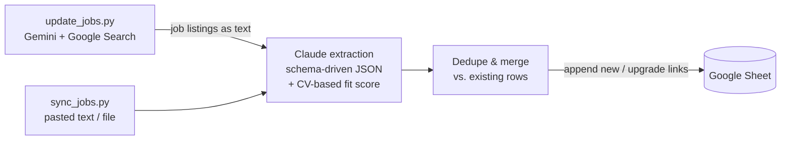

# JoTra — LLM-powered job tracker

[](https://github.com/Ramunka/jotra-job-tracker/actions/workflows/ci.yml)


JoTra keeps a Google Sheet of open job postings up to date with no manual copy-paste.
It finds jobs on the live web with **Gemini** (Google Search grounding) and turns
unstructured listings into clean rows with **Claude**. It can also score each job against
the candidate's CV. Finally, it merges everything into the sheet without creating
duplicates or overwriting your own notes.

I built it for my own job search. The sheet stays a normal Google Sheet that I can sort,
filter and annotate by hand, and the tool only adds to it.

## How it works



1. **Find:** `update_jobs.py` sends a per-profile search prompt to Gemini with live Google
   Search enabled, optionally with the candidate's CV attached. Or you paste listings
   into `sync_jobs.py` yourself.
2. **Extract:** Claude converts the free-form text into a JSON array. The fields come from
   the profile's column schema, so different sheets can track different columns.
3. **Score:** if the profile has `fit score` / `fit reason` columns, the CV is attached as a
   PDF. Claude rates each job 1–10 with short pro/con reasons.
4. **Merge:** jobs are matched against existing rows on configurable keys. Matching ignores
   case and surrounding whitespace. New jobs are appended. Existing rows are only touched
   when a later run finds a real posting link the row was missing.
5. **Report:** the terminal shows what was added, upgraded, skipped as a duplicate, or
   rejected as invalid.

## Engineering highlights

- **Schema-driven extraction:** a profile's `columns` in JSON define both the sheet layout
  and the LLM prompt. Adding a column needs no code change.
- **Safe by default:** every run writes to a separate `test` worksheet unless `--prod` is
  passed. Rows are appended, never rewritten wholesale, so editing the sheet during a run
  is safe. Your `STATUS` and `COMMENTS` columns are never overwritten.
- **Hallucination guardrails:**
  - Non-URL "links" are dropped rather than written as broken hyperlinks.
  - Every row also gets a Google search fallback link.
  - `--verify-links` resolves Gemini's grounding citations and flags any URL in its
    answer that doesn't match a real search result.
- **Consistent scoring:** the fit-score prompt is an editable text file with explicit rules:
  - hard cutoffs for requirements the candidate can't meet
  - no penalty for overqualification
  - the same skill assessment across every job in a batch
- **Resilience:**
  - Transient Google Sheets errors (429/5xx) are retried with backoff. A custom HTTP client
    handles the HTML-bodied 502s that gspread's built-in backoff misses.
  - Gemini server errors are retried.
  - Every failure ends in a single clear message rather than a traceback.
- **Locale-aware formulas:** `HYPERLINK` separators switch between `,` and `;` to match the
  spreadsheet's locale.
- **Tested pure core:** the dedupe/merge logic does no I/O. It's covered by unit tests that
  need no API keys, and CI runs them with linting on every push.

## Project structure

```
jotra/
  cli.py          argument parsing, test/prod mode, friendly error handling
  config.py       profiles, credentials, per-profile prompt and CV lookup
  search.py       Gemini web search and grounding-based link verification
  extraction.py   schema-driven Claude extraction and fit scoring
  dedupe.py       pure merge logic: new / upgrade / duplicate / invalid
  sheets.py       Google Sheets I/O, retrying HTTP client, row and link cells
  pipeline.py     extract -> dedupe -> write -> report
sync_jobs.py      entry point: paste text or pass --input file
update_jobs.py    entry point: Gemini search, then the same pipeline
prompts/          example search and fit-score prompts
tests/            unit tests with recorded fixtures (no network)
```

## Setup

Requires Python 3.10+.

```bash
python -m venv .venv && source .venv/bin/activate   # Windows: .venv\Scripts\activate
pip install -r requirements.txt
cp .env.example .env                                # then fill in your API keys
cp profiles.example.json profiles.json              # then set your sheet ID(s)
```

You'll need:

1. **Anthropic API key:** from [console.anthropic.com](https://console.anthropic.com).
   Goes in `ANTHROPIC_API_KEY`.
2. **Gemini API key:** from [aistudio.google.com/apikey](https://aistudio.google.com/apikey).
   Goes in `GEMINI_API_KEY`. Only `update_jobs.py` uses it.
3. **Google service account:**
   1. In [Google Cloud Console](https://console.cloud.google.com), enable the Google Sheets
      API and the Google Drive API.
   2. Create a service account and download a JSON key as `credentials.json` into the
      project folder.
   3. Share your sheet with the service account's `client_email` as **Editor**.

`.env`, `credentials.json`, `profiles.json`, your CVs and your personal prompts are all
gitignored.

## Usage

```bash
# Paste listings interactively (finish with a line containing END), or pass a file
python sync_jobs.py example
python sync_jobs.py example --input jobs.txt

# Search the web with Gemini, then extract, score and merge
python update_jobs.py example
python update_jobs.py example --verify-links   # flag links not backed by a real search result
python update_jobs.py example --no-cv          # don't attach the CV to the search
python update_jobs.py example --dump           # save Gemini's raw answer to gemini_text.txt

# Add --prod to write to the real worksheet instead of the test one
python update_jobs.py example --prod
```

## Configuration

### Profiles (`profiles.json`)

Each profile points at one Google Sheet and defines its columns, in order:

```json
{"header": "posted or suggested salary", "source": "salary"}
{"header": "shift", "source": "shift", "description": "the work shift or schedule, if mentioned"}
```

- `header` is the exact text in row 1 of the sheet.
- `source` is the field that fills it:
  - **Computed, never sent to the LLM:** `date_added`, `status` (`NEW` on insert),
    `comments` (blank) and `search_link` (a Google search for the job).
  - **Built-in extracted fields:** `domain`, `employer`, `position`, `location`, `salary`,
    `qualifications`, `summary` and `link`. `link` is written as a clickable `HYPERLINK`
    when it's a real URL.
  - **Anything else** is a custom field and needs a `description` telling Claude what to
    extract.
  - **`fit_score` / `fit_reason`** turn on CV-based scoring and need
    `prompts/cv/<profile>.pdf`.
- `dedupe_keys` (default `["position", "employer"]`) sets which fields identify a job.
- `TEST_worksheet_name` is the tab used when `--prod` isn't passed.
- `params.gemini_temperature` optionally tunes how varied the search results are.

`profiles.example.json` has two profiles: one with fit scoring, and one with a custom
`shift` column.

### Prompts

| File | Purpose |
|------|---------|
| `prompts/<profile>.txt` | What Gemini should search for: roles, level, location, recency, output format. See `prompts/example.txt`. |
| `prompts/fit_score/<profile>.txt` | Optional scoring rules for the fit score. See `prompts/fit_score/example.txt`. |
| `prompts/cv/<profile>.pdf` | The candidate's CV, attached to both Gemini and Claude. Gitignored. |

Each path can be overridden per profile with `gemini_prompt_file`, `fit_score_prompt_file`
or `cv_file`.

### Models

- **Gemini:** set with the top-level `gemini_model` in `profiles.json`.
- **Claude:** defaults to `claude-sonnet-5`.
- **One-off override:** set the `GEMINI_MODEL` or `CLAUDE_MODEL` environment variable.

## Development

```bash
pip install -r requirements-dev.txt
pytest -q          # unit tests, no API keys needed
ruff check . && ruff format --check .
```

## Roadmap

- **API cost tracking:** log Claude and Gemini token usage per run, with an estimated cost.
- **Outreach drafts:** generate a short CV-tailored pitch for each job that has a
  confirmed posting link.
- **Link-health checks:** periodically re-check saved postings and flag expired ones.
- **Scheduled digest:** run on a schedule and send a summary of new matches.

## How this was built

I designed, built and tested JoTra myself, and I use it day-to-day in my own job search. I
made the product decisions and the architecture, including:

- the schema-driven profiles
- the test/prod split
- the merge rules
- the fit-scoring criteria
- the link-verification approach

I validated each feature against real job searches and live sheets.

I developed it with an AI coding assistant (Claude Code). I used it to speed up
implementation, refactoring, tests and documentation. I reviewed, directed and iterated
on every change.

## License

[MIT](LICENSE) © 2026 Roman Nebrat
